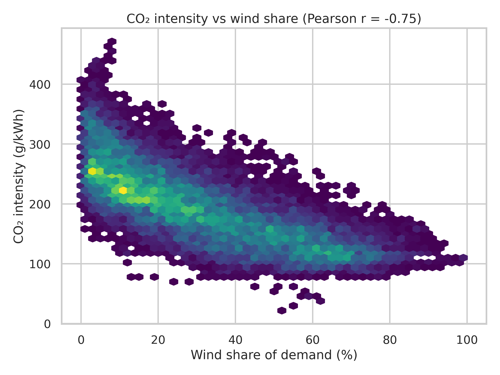
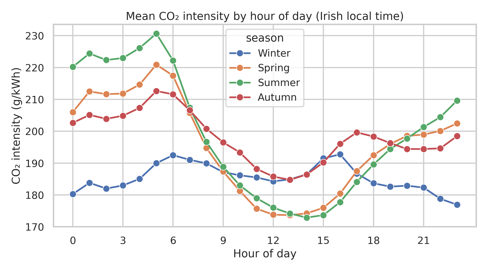
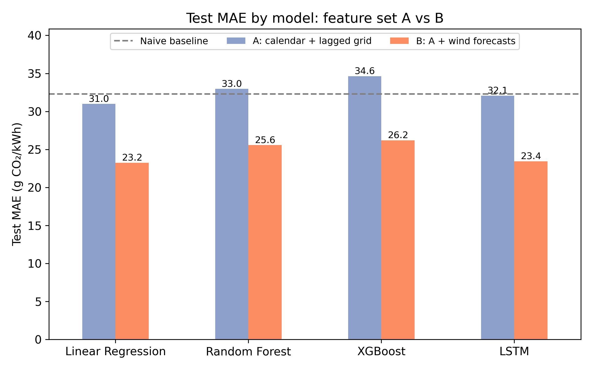
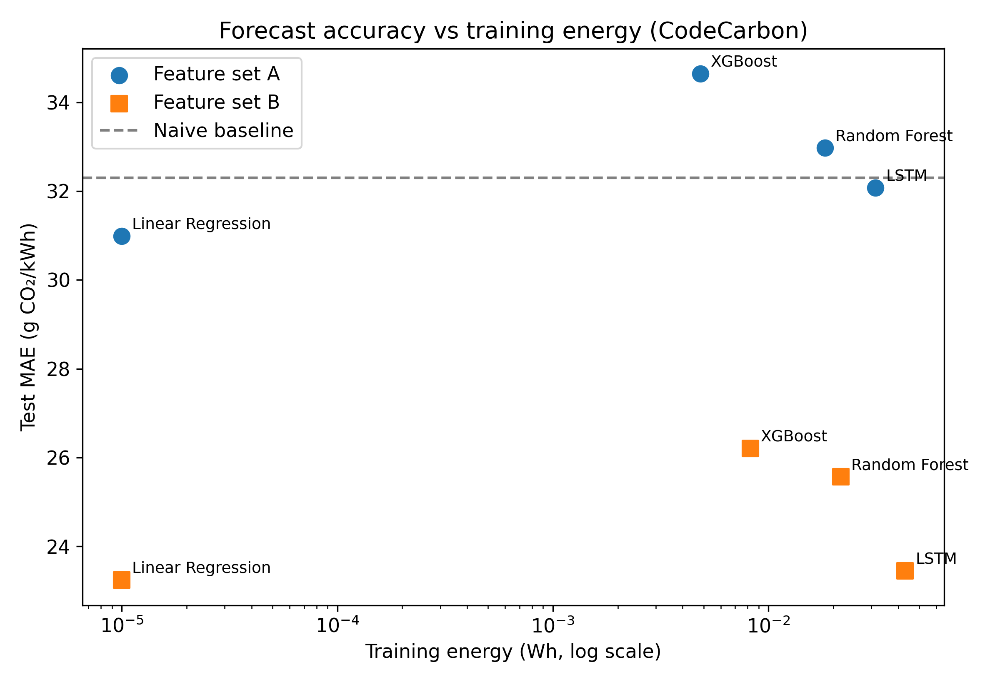
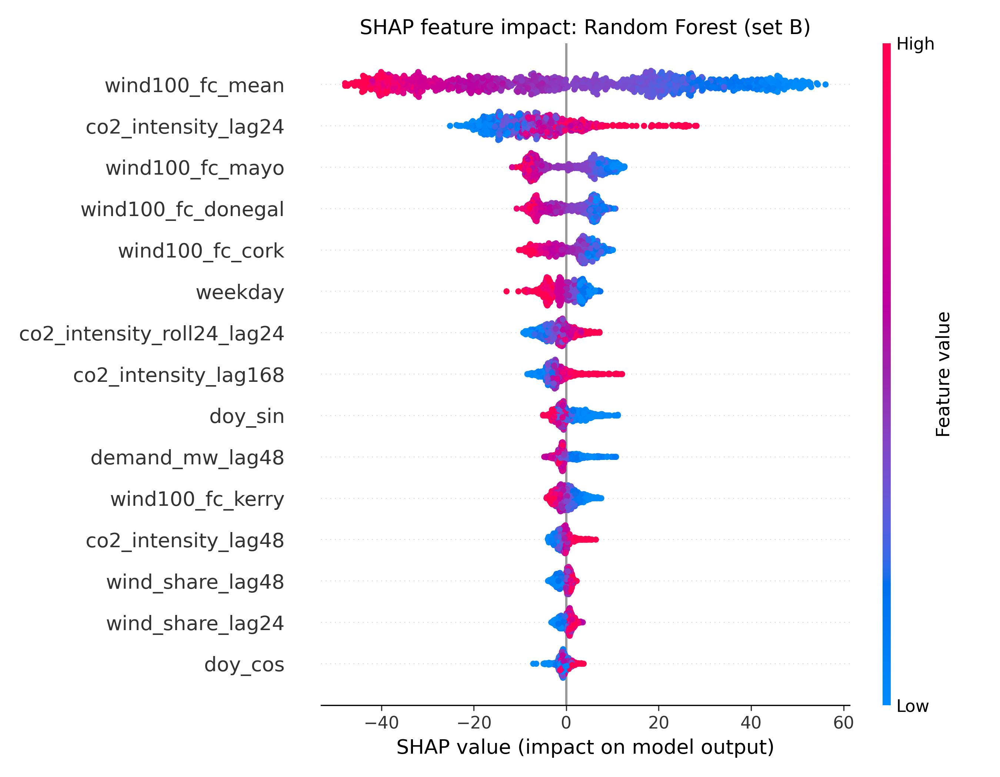
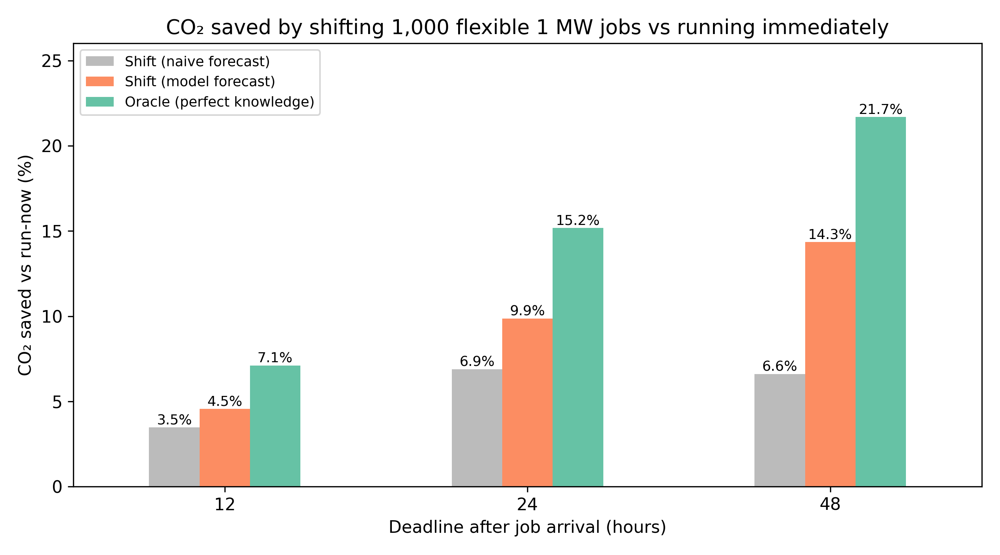

# Carbon-Aware Scheduling of Data Centre Workloads on the Irish Grid

MSc AI group CA · H9ETS *Emerging AI Technologies and Sustainability* · National College of Ireland, 2026

> **Research question.** Can official weather forecasts improve 24-hour-ahead CO₂ intensity prediction for Ireland's
> grid, and how much CO₂ can data centres avoid by shifting flexible workloads to predicted low-carbon hours, once the
> forecaster's own training energy is counted?

---

## TL;DR

| | Result |
|---|---|
| 🌬️ **Weather forecasts help** | Adding 24 h-ahead wind forecasts cuts forecast error by **22–27 %** for every model |
| 📉 **Best forecaster** | Linear Regression + wind forecasts: **MAE 23.2 g/kWh** (naive baseline 32.3) — **28 % better** |
| ♻️ **CO₂ avoided** | Shifting jobs within a 24 h deadline saves **9.9 %** of job CO₂ (106.7 t over 1,000 jobs) — **65 %** of the theoretical maximum |
| ⚡ **Forecaster's footprint** | Training all 8 models emitted **~0.04 g CO₂** — about **3 billion times less** than it saves |

---

## Why this matters

Data centres used **23 % of Ireland's metered electricity in 2025** (CSO). The carbon intensity of that electricity
swings hour to hour: windy hours are clean, calm gas-heavy hours are dirty. Many data-centre jobs — AI training,
batch processing, backups — are *flexible* and could run a few hours later without anyone noticing, yet they usually
run immediately regardless of how clean the grid is.

This project forecasts tomorrow's clean hours and simulates moving flexible jobs into them.

---

## How the project works

```
 EirGrid Smart Grid Dashboard ─┐                       ┌─► 01_eda.ipynb ──► EDA figures
  (CO₂, wind, demand, solar)   │                       │
                               ├─► download.py ─► build_dataset.py ─► clean_hourly.csv
 Open-Meteo Previous Runs ─────┘   (raw JSON,      (UTC, hourly,       │
  (24 h-ahead wind forecasts)       cached)         gap-filled)        ▼
                                                              features.py + train.py
                                                         (models A vs B, CodeCarbon, SHAP)
                                                                       │
                                                                       ▼
                                                                 scheduler.py
                                                     (job-shifting simulation, CO₂ saved)
                                                                       │
                                                                       ▼
                                                              results/summary.md
```

### 1. Download — `src/download.py`
- **EirGrid Smart Grid Dashboard** (Republic of Ireland): CO₂ intensity, CO₂ emissions, wind generation, demand and
  solar at 15-minute resolution, one request per day. This is the unofficial chart endpoint the website uses; it
  needs a browser `User-Agent` and blocks cloud IPs, so it is run locally.
- **Open-Meteo Previous Model Runs API**: hourly 100 m wind speed at four wind-farm regions (Donegal, Mayo, Kerry,
  Cork). The `_previous_day1` variable is the forecast **issued 24 h earlier** — exactly what would have been known
  at decision time.
- Every day/month is cached as JSON in `data/raw/`, so the script can be re-run after failures and skips finished work.

### 2. Build the dataset — `src/build_dataset.py`
1. Parse JSON → convert Europe/Dublin local time to UTC (handling the repeated October hour and missing March hour).
2. Average 15-min values to hourly.
3. Where EirGrid omitted CO₂ intensity, derive it as `emissions ÷ demand × 1000` and flag it (`co2_intensity_filled`).
4. Merge Open-Meteo forecasts, add calendar features (hour, weekday, month, Irish public holidays) and wind share.

Output: **`data/processed/clean_hourly.csv` — 21,241 hourly rows, 1 Jun 2024 → 2 Nov 2026.**

### 3. Explore — `notebooks/01_eda.ipynb`
Generated by `src/make_eda_notebook.py`; produces the exploratory figures plus `results/summary_stats.csv` and
`results/dataset_description.csv`.

### 4. Forecast — `src/features.py`, `src/train.py`
- **Target:** hourly CO₂ intensity (g/kWh) for each hour of the next day.
- **No leakage:** grid features are only used if ≥ 24 h old; the only weather input is the 24 h-ahead forecast.
  Realised wind is never a model input.
- **Feature set A (21 features):** calendar + lagged grid features (CO₂, wind, demand, wind share at 24/48/168 h lags).
- **Feature set B (26 features):** A + 24 h-ahead wind forecasts at 4 sites + their mean.
- **Models:** naive (same hour yesterday), Linear Regression, Random Forest, XGBoost, LSTM.
- **Time-based split:** train Jun 2024 → Mar 2026 · validation Mar → May 2026 · test May → Nov 2026.
- **Energy accounting:** every training run is wrapped in a CodeCarbon tracker (country = Ireland).
- **Explainability:** SHAP on the best tree model.

### 5. Schedule — `src/scheduler.py`
1,000 simulated flexible jobs in the test period (random arrival, 4–8 h long, constant 1 MW, must finish before a
12/24/48 h deadline). Four policies pick a start time:

| Policy | Chooses the window with… |
|---|---|
| Run now | — (starts on arrival) |
| Shift (naive forecast) | lowest CO₂ according to "same hour yesterday" |
| Shift (model forecast) | lowest CO₂ according to the best model |
| Oracle | lowest **actual** CO₂ (perfect-knowledge upper bound) |

All policies are **scored with actual CO₂ intensity**, never the predicted one.

---

## Key findings

### 1. Wind drives Irish grid carbon intensity
- CO₂ intensity vs wind share of demand: **Pearson r = −0.75** (20,123 hours).
- Monthly mean ranged from **155 g/kWh** (Mar 2026) to **255 g/kWh** (Nov 2024), moving opposite to wind share.
- Open-Meteo's 24 h-ahead wind forecast is good: **MAE 0.77 m/s, r = 0.95** vs realised wind; **r = 0.86** vs
  EirGrid wind output.
- In spring/summer the cleanest hours are ~14:00–15:00 local (solar) and the dirtiest ~05:00; in winter the daily
  profile is flat — so in winter *weather*, not the clock, decides when the grid is clean.

<p align="center">
  
  
</p>

### 2. Weather forecasts are the missing ingredient
Without wind forecasts (set A), no model meaningfully beats "same hour yesterday". With them (set B), every model
improves by roughly a quarter.

| Model | MAE set A | MAE set B | Improvement | MAPE (B) |
|---|---|---|---|---|
| Naive baseline | 32.30 | – | – | 18.9 % |
| **Linear Regression** | 30.99 | **23.25** | **−25.0 %** | 14.4 % |
| Random Forest | 32.97 | 25.57 | −22.5 % | 15.5 % |
| XGBoost | 34.64 | 26.21 | −24.3 % | 16.0 % |
| LSTM | 32.08 | 23.45 | −26.9 % | 14.0 % |

<p align="center"></p>

### 3. Simple beats complex
Linear Regression was the most accurate model and trains in 0.02 s. The LSTM matched it on MAPE but cost ~4,000×
more energy. When the right input (the weather forecast) is available, model complexity adds little.

<p align="center"></p>

### 4. The model relies on the wind forecast
SHAP (Random Forest, set B): the 4-site mean wind forecast has a mean |SHAP| of **24.7 g/kWh — 2.6× the next feature**
(yesterday's CO₂ intensity, 9.5). Four of the top five features are wind forecasts.

<p align="center"></p>

### 5. Carbon-aware shifting saves real CO₂ — and flexibility pays
| Deadline | Naive-forecast shifting | **Model-forecast shifting** | Oracle (max possible) |
|---|---|---|---|
| 12 h | 3.5 % | **4.6 %** | 7.1 % |
| 24 h | 6.9 % | **9.9 %** (106.7 t) | 15.2 % |
| 48 h | 6.6 % | **14.3 %** | 21.7 % |

*(% of CO₂ saved vs running immediately, 1,000 jobs × 1 MW.)* The model consistently captures **~65 %** of the
theoretical maximum saving, versus 30–49 % for the naive forecast. The longer a job can wait, the more it saves.

<p align="center"></p>

### 6. The forecaster pays for itself instantly
| | CO₂ |
|---|---|
| Saved by model-forecast shifting (24 h deadline) | **106.67 t** |
| Emitted training all 8 models | **0.037 g** |
| Ratio | **≈ 2.9 × 10⁹** |

The jobs use the same energy either way — only *when* they run changes, and therefore how much CO₂ that energy carries.

---

## Limitations

- Forecast history only exists from **June 2024** (~2.4 years); the validation window is short (939 h).
- The EirGrid endpoint is **unofficial and undocumented**; 16 days of CO₂ and 19 days of demand data were unrecoverable.
- **2,409 hours** of CO₂ intensity are derived (emissions ÷ demand) rather than published.
- Jobs are **simulated** (no public Irish data-centre workload data); constant 1 MW, no capacity or queue limits.
- **Average, not marginal**, emission factors — shifting very large loads could itself change which plants run.
- The 48 h case reuses 24 h-ahead forecasts for hours 24–48, so it is optimistic.
- CodeCarbon energy figures are **estimates**; very short runs are hard to measure.
- One test period (May–Nov 2026); results may differ in winter.

## Future work

- Marginal emission factors or a dispatch model.
- 48–72 h, solar and demand forecasts for longer deadlines.
- Probabilistic forecasts so the scheduler can account for risk.
- Rolling-origin evaluation across all seasons.
- Real data-centre workload traces, power limits and cooling (PUE).
- An official data source such as the ENTSO-E Transparency Platform.

---

## Reproduce it

Requires Python 3.12+ (Windows `py` launcher shown; use `python` elsewhere).

```bash
py -m pip install -r requirements.txt
# PyTorch CPU build: py -m pip install torch --index-url https://download.pytorch.org/whl/cpu

py src/download.py                 # ~2.5 years of raw data (cached; safe to re-run)
                                   # quick test: py src/download.py --start 2025-06-14 --end 2025-06-16
py src/build_dataset.py            # -> data/processed/clean_hourly.csv
py src/make_eda_notebook.py        # -> notebooks/01_eda.ipynb (then run it in Jupyter)
py src/train.py                    # models, CodeCarbon, SHAP   (smoke test: --quick)
py src/scheduler.py                # job-shifting simulation
```

> Run `download.py` on a local machine — EirGrid blocks/times out from cloud IPs such as Google Colab.
> All random seeds are fixed (42).

## Repository layout

```
├── src/
│   ├── download.py           # EirGrid + Open-Meteo downloader (cached, retries)
│   ├── build_dataset.py      # raw JSON -> clean hourly CSV
│   ├── make_eda_notebook.py  # generates the EDA notebook
│   ├── features.py           # leakage-safe feature sets A and B
│   ├── train.py              # models, metrics, CodeCarbon, SHAP, figures
│   └── scheduler.py          # carbon-aware job-shifting simulation
├── notebooks/01_eda.ipynb    # exploratory analysis
├── data/
│   ├── raw/                  # cached JSON (not committed)
│   └── processed/clean_hourly.csv
├── results/                  # CSV tables + summary.md (all numbers for the report)
├── figures/                  # PNG figures, 300 dpi
├── report/                   # report drafts
├── CLAUDE.md                 # project brief: data sources, experiment rules, status
└── PROMPTS.md                # phase-by-phase prompts used to build the project
```

| Output | Contents |
|---|---|
| `results/model_results.csv` | MAE, RMSE, MAPE, training time, energy and emissions per model/feature set |
| `results/best_predictions.csv` | Hourly actual vs predicted (best model) vs naive on the test set |
| `results/shap_importance.csv` | Mean \|SHAP\| per feature |
| `results/scheduler_results.csv` | CO₂ per policy and deadline |
| `results/carbon_payback.csv` | CO₂ saved vs CO₂ spent training |
| `results/summary_stats.csv`, `dataset_description.csv` | Dataset statistics |
| `results/summary.md` | Full write-up of every number and figure for the report |

## Data sources & credits

- **EirGrid Smart Grid Dashboard** — https://www.smartgriddashboard.com (ROI system data).
- **Open-Meteo** Previous Model Runs API — https://open-meteo.com (CC BY 4.0, non-commercial use).
- **CodeCarbon** for training-energy estimates — https://codecarbon.io.
- Central Statistics Office (CSO) Ireland — data-centre electricity consumption statistics.
